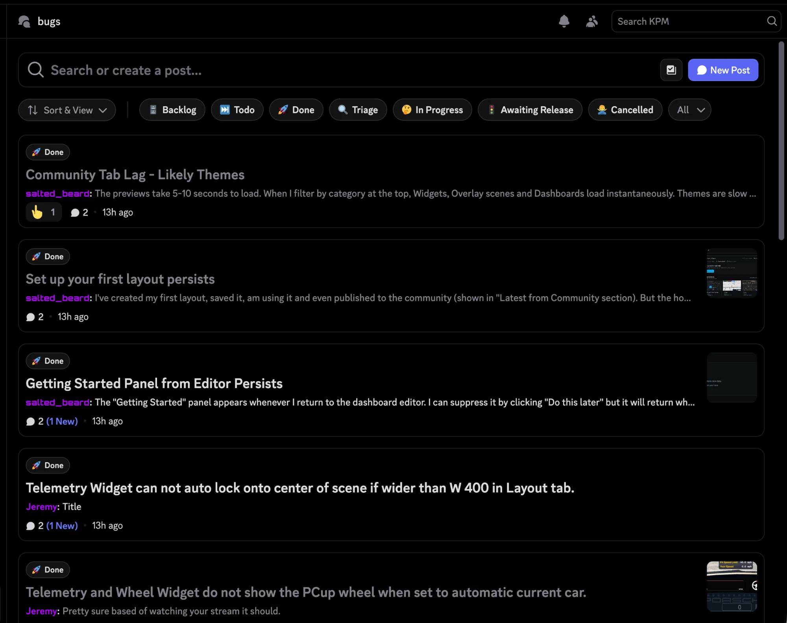

# Discord forum to Linear sync

This bot connects a Discord forum channel to Linear. It runs on Cloudflare Workers.



- Each new forum post becomes a Linear issue in Triage within a minute. The issue gets the post text, the attachments, and a link to the thread.
- The bot replies once in the thread with the issue ID, for example "Tracked as ENG-123".
- When the issue status changes in Linear, the bot changes the status tag on the thread. Other tags do not change.
- When the issue is done, the bot tells the reporter. After 7 days, it archives the thread.

Linear controls the status. The bot does not send changes from Discord to Linear. It also does not copy replies or edits.

## How it works

Discord does not send webhooks for new posts. For this reason, the bot checks the forums for new posts every minute. Linear sends a webhook when an issue changes, so tags change within seconds. Every 30 minutes, the bot also finds status changes that it missed, finds deleted posts, and tries failed updates again. When a post is deleted, the bot adds a comment to its Linear issue.

The bot does not stay connected to Discord. For this reason, it shows as offline in the member list of your server.

## Setup

You need Node 24, pnpm, a Cloudflare account, a Discord server that you manage, and a Linear workspace. Node 22 also works. To install pnpm, run `npm install -g pnpm`.

### 1. Create the Discord bot

1. Go to https://discord.com/developers/applications and click **New Application**.
2. Open **Bot** and click **Reset Token**. Keep the token for step 4.
3. On the same page, turn on **Message Content Intent**. The bot needs it to read the posts.

### 2. Get a Linear API key

1. In Linear, go to **Settings → Security & access → Personal API keys** and create a key.
2. Turn on Triage for the team that gets the issues: **Team settings → Triage**.

The bot creates issues as the owner of the key. Use the key of a workspace admin so that setup can create the Linear webhook.

### 3. Add status tags to your forums

In the settings of each forum, add one tag for each Linear status that you want to show. Give each tag the same name as the status, for example Triage, Todo, In Progress, and Done. Common names such as Fixed and Closed also work.

Set each status tag to **Only allow moderators to apply this tag**. Then users cannot mark their own post as Done.

A tag with the same name as a Linear label, for example Bug, adds that label to new issues.

### 4. Run setup

```bash
pnpm install
pnpm run setup
```

Type `pnpm run setup` and `pnpm run deploy` in full. `pnpm setup` and `pnpm deploy` are different pnpm commands.

Setup asks for the bot token and the Linear key. Then it:

1. Gives you a link to add the bot to your server.
2. Lets you select the forums and the Linear team.
3. Matches the forum tags to Linear statuses and labels.
4. Creates the database and deploys the bot to Cloudflare.
5. Creates the Linear webhook.
6. Makes sure that the bot can reach Discord and Linear.

You can run setup again at any time. It keeps what already exists.

Your IDs and keys stay on your computer in `src/config.local.ts` and `.dev.vars`. Git ignores both files.

### 5. Test it

1. Create a post in the forum.
2. Make sure that a Linear issue appears in Triage within a minute.
3. Move the issue to In Progress. Make sure that the tag on the thread changes.

To see the logs, run `pnpm wrangler tail`.

## Make changes

- To change the tag mappings, the messages, or the archive time, edit `src/config.local.ts`. Then run `pnpm run deploy`. The file `src/config.ts` explains each setting.
- To add a forum or new tags, run `pnpm run setup` again. When it asks to keep the config, answer "n". Your current mappings stay.
- You can rename a tag in Discord. The bot uses tag IDs, not tag names.
- Always deploy with `pnpm run deploy`. A plain `pnpm wrangler deploy` fails, because only `.dev.vars` has your database ID.

## Fix problems

**Posts do not create issues.** Run `pnpm run setup` again. It checks the bot token, the Message Content Intent, and the connection to Discord and Linear.

**Issues have no text.** Turn on Message Content Intent. See step 1.

**pnpm shows "Failed to switch pnpm".** Your pnpm is too old to start the pnpm version of this project. Run `npm install -g pnpm`. If you installed pnpm with Homebrew, run `brew upgrade pnpm`.

**A status change does not change the tag.** Make sure that the bot has the Manage Threads permission in the forum. Make sure that `src/config.local.ts` maps the status to a tag. The scheduled job also fixes missed changes within 30 minutes.

**A tag disappeared.** Discord allows 5 tags on a thread. When a thread has too many tags, the bot keeps the status tag.

## Admin requests

Send these requests to your Worker URL with your `ADMIN_TOKEN` from `.dev.vars`:

```bash
curl -X POST -H "Authorization: Bearer $ADMIN_TOKEN" https://your-worker.workers.dev/admin/retry/THREAD_ID
```

| Request | Use |
|---|---|
| `POST /admin/sweep` | Run all scheduled jobs now and show the result of each job. |
| `POST /admin/retry/THREAD_ID` | Add one post now. Use it for posts from before setup. |
| `POST /admin/resync/THREAD_ID` | Update the tags of one thread now. |

The thread ID is the last number in the link to the post.

## Cost

The bot uses very little of the Cloudflare free plan. It does not use Durable Objects.

- The check for new posts runs 1,440 times a day. The free plan allows 100,000 requests a day.
- Each Linear change adds one request.
- The database use is a small part of the free limits.

## Development

```bash
pnpm test
pnpm run typecheck
```

The tests run in the Workers runtime. They use fake Discord and Linear APIs.

## License

MIT. See [LICENSE](LICENSE).
